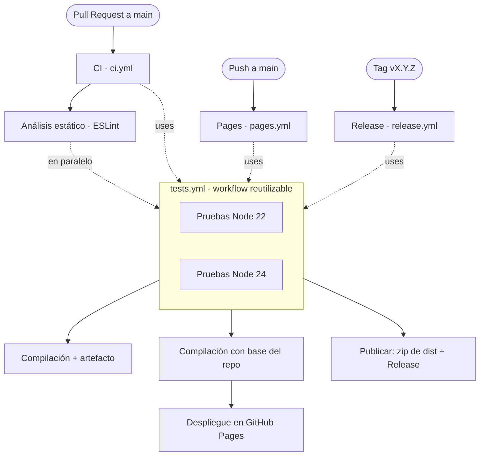

# Pipeline de CI/CD

Documentación del pipeline tras el reto final: análisis estático en paralelo,
workflow de pruebas reutilizable, permisos de mínimo privilegio, mantenimiento
automático con Dependabot y publicación de releases por etiqueta.

## Diagrama del pipeline

> `lint` y las pruebas (`tests.yml`) arrancan a la vez dentro de `ci.yml`: el job
> `lint` no declara `needs`, por lo que no espera a las pruebas.

## Tabla de workflows

| Workflow | Archivo | Evento disparador | Jobs | Propósito |
|----------|---------|-------------------|------|-----------|
| Pruebas (reutilizable) | `tests.yml` | `workflow_call` | `test` (matriz Node 22 y 24) | Única definición de la matriz de pruebas; la invocan los demás workflows. |
| CI | `ci.yml` | `pull_request` a `main`, `workflow_dispatch` | `test` (→ `tests.yml`), `lint`, `build` | Valida cada PR: pruebas y ESLint en paralelo; si pasan, compila y sube artefacto. |
| Desplegar en Pages | `pages.yml` | `push` a `main`, `workflow_dispatch` | `test` (→ `tests.yml`), `build`, `deploy` | Prueba, compila con la ruta base del repositorio y despliega en GitHub Pages. |
| Release | `release.yml` | `push` de tag `v[0-9]+.[0-9]+.[0-9]+` | `test` (→ `tests.yml`), `publish` | Prueba, compila, comprime `dist` y crea una Release con el `.zip` adjunto. |

### Permisos (mínimo privilegio)

| Workflow / Job | Permisos |
|----------------|----------|
| Todos (por defecto) | `contents: read` |
| `release.yml` → `publish` | `contents: write` (crear la Release) |
| `pages.yml` → `deploy` | `pages: write`, `id-token: write` |

El mantenimiento de dependencias está automatizado en `.github/dependabot.yml`
(ecosistemas `npm` y `github-actions`, revisión semanal).

## Incidencias provocadas

### Incidencia 1 — Error de ESLint hace fallar el PR

- **Qué se cambió:** se introdujo intencionadamente una variable sin usar en
  `src/estadisticas.js` (`const sinUsar = 1;`) para comprobar que el análisis
  estático bloquea el merge.
- **Qué job falló:** `lint` (job "Análisis estático" de `ci.yml`). El job de
  pruebas (`tests.yml`) terminó en verde en paralelo, lo que confirma que ambos
  se ejecutan de forma independiente.
- **Cómo se diagnosticó:** en los logs del job `lint`, ESLint reportó
  `'sinUsar' is assigned a value but never used (no-unused-vars)` con el archivo y
  la línea. En el grafo de ejecución del PR, el check de lint aparecía en rojo y
  el botón de merge quedó bloqueado por el ruleset de la rama.
- **Cómo se corrigió:** se eliminó la línea sobrante. Al volver a subir el commit,
  el job `lint` pasó a verde y el PR volvió a ser fusionable.

### Incidencia 2 — Checks requeridos obsoletos tras el workflow reutilizable

- **Qué se cambió:** al mover la matriz de pruebas a `tests.yml` (R2), el nombre
  de los checks cambió (pasaron a mostrarse como `Pruebas / Pruebas (Node 22)` en
  lugar de `Pruebas (Node 22)`).
- **Qué falló:** el ruleset de `main` seguía exigiendo los nombres antiguos, que
  ya nunca se reportaban, por lo que los PR quedaban bloqueados esperando checks
  que no existían.
- **Cómo se diagnosticó:** en el PR, la sección de checks requeridos mostraba los
  antiguos como "Expected — Waiting for status to be reported".
- **Cómo se corrigió:** se actualizaron los checks requeridos del ruleset a los
  nuevos nombres generados por el workflow reutilizable.
